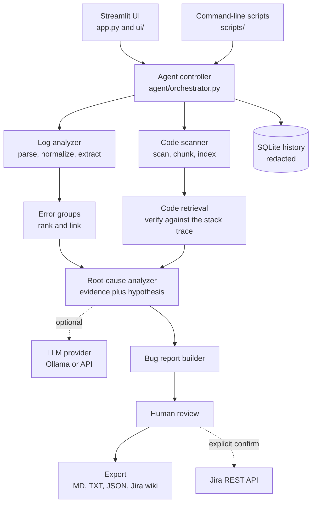

# Bug Report & Log Analyzer Agent

Turn a large, messy application log into **measured evidence**, a clearly labeled **root-cause hypothesis**, the **real source code** involved, and a **Jira-ready bug report**. Free and local by default: no paid API needed.

> **Status: 1.0.0-rc1 (release candidate).** Everything below is implemented and covered by automated tests. Not included: screenshots, a demo recording, and benchmark numbers (you generate your own: see [Benchmarking](#benchmarking)). Before calling it 1.0.0, follow [docs/release_checklist.md](docs/release_checklist.md); what is and is not verified is listed in [docs/acceptance.md](docs/acceptance.md). History: [CHANGELOG.md](CHANGELOG.md). Contributing: [CONTRIBUTING.md](CONTRIBUTING.md).

## The problem
During an incident, an engineer scrolls through thousands of log lines, greps for the error, hunts for the code that raised it, and then writes a ticket from scratch. It is slow, easy to get wrong, and the result mixes facts with guesses.

## The solution
The tool parses the log, groups similar errors, ranks them, finds the matching code, assembles the evidence, and drafts the bug report. It keeps two things strictly apart:

- **Observed evidence**: counts, timestamps, call paths and source lines measured from your files, each with its source.
- **Inference**: a hypothesis, alternatives and fixes, always labeled as unconfirmed.

Source snippets are real file lines and are marked **verified** only when the stack-trace line really matches the code. Nothing is invented.

## Features
- **Log parsing**: bracketed, generic text and JSON-lines formats; multi-line stack traces (Python, Java, JavaScript); UTF-8 and UTF-16 files; ANSI colors stripped. Details: [docs/log_formats.md](docs/log_formats.md)
- **Error grouping**: normalizes ids and numbers, groups by root exception and raise site, ranks groups, links groups that share request IDs. [docs/grouping.md](docs/grouping.md)
- **Code retrieval**: scans a local project (Python, JavaScript, TypeScript, Java), finds the file, function and lines for each stack frame, and says exactly how well each match was verified. [docs/code_retrieval.md](docs/code_retrieval.md)
- **Root-cause analysis**: rule-based analysis with timing patterns, precursor warnings and a heuristic confidence score whose parts are all shown. [docs/root_cause.md](docs/root_cause.md)
- **Optional local LLM** (Ollama) or any OpenAI-compatible API: it may only rewrite the hypothesis, must cite real evidence, and its output is validated with a safe fallback. [docs/llm.md](docs/llm.md)
- **Jira-ready reports**: Markdown, plain text, JSON and Jira wiki markup, with a human-review step. Nothing is sent to Jira unless you configure it and confirm. [docs/jira_report.md](docs/jira_report.md)
- **Streamlit UI** with 8 pages and a one-minute demo. [docs/ui.md](docs/ui.md)
- **Safety**: secret redaction, no execution of uploaded code, path policy, and a locked-down public-demo mode. [SECURITY.md](SECURITY.md)
- **Benchmark and test tooling**: [docs/benchmarking.md](docs/benchmarking.md), [docs/testing.md](docs/testing.md)

## Architecture

More diagrams (data flow, trust boundaries): [docs/architecture.md](docs/architecture.md).

## How it works
1. **Ingest**: validate the file, read it as a stream, strip terminal escapes, cap line length.
2. **Parse and normalize**: split into events, attach stack traces, normalize levels and timestamps.
3. **Extract and group**: find the root exception and raise site; group similar events; rank by severity and frequency.
4. **Retrieve code**: map each stack frame to the scanned project and verify the line text.
5. **Analyze**: build the evidence list, timing pattern and hypothesis (rules); optionally refine the hypothesis with an LLM.
6. **Report**: build the Jira-ready draft, redact secrets, let a human edit and mark it reviewed, then export.

Only the top groups are analyzed in depth, and a model (if used) sees redacted evidence, never the whole log.

## Tech stack
Python 3.11+, Streamlit, SQLite, Pandas, Pydantic, pytest. LLM: Ollama (local, optional) or any OpenAI-compatible API (optional). HTTP is plain `urllib`; there is no database server, queue or cloud dependency.

## Demo
No recording has been made yet. You can run the whole demo locally in about a minute:
1. `streamlit run app.py`
2. Dashboard → **Load demo and analyze**
3. Error Groups → pick `G001` → Root Cause Analysis → Code Explorer → Bug Report → tick *I have reviewed this report* → download.

The demo uses a synthetic log and a small synthetic project in `demo/`; the log's stack traces point at real lines of that code.
To record it: `python scripts\demo_check.py`, rehearse with `python scripts\demo_rehearsal.py`, then follow [docs/demo.md](docs/demo.md). `python scripts\gif_markdown.py` validates your GIF and prints the line to paste here.

## Screenshots
No screenshots are included yet. Capture them from the running demo ([guide](docs/screenshots.md)), then run `python scripts\screenshot_markdown.py` and paste its output here.

## Installation (Windows 10/11, PowerShell, VS Code)
You need Python 3.11 or newer (`python --version`).
```powershell
cd path\to\bug-report-log-analyzer
python -m venv .venv
.venv\Scripts\activate
python -m pip install --upgrade pip
pip install -r requirements.txt
```
If PowerShell blocks the activate script: `Set-ExecutionPolicy -Scope CurrentUser RemoteSigned`, then open a new window.
In VS Code: `code .`, then *Ctrl+Shift+P → Python: Select Interpreter → `.venv`*.

## Run
```powershell
streamlit run app.py
```
Command-line version of the pipeline (no browser):
```powershell
python scripts\analyze_cli.py                                   # bundled demo
python scripts\analyze_cli.py --log path\to\app.log --repo path\to\project --group G001 --export out
```

## Optional: local LLM with Ollama
The tool works without it. To refine the hypothesis with a model:
1. Install Ollama from https://ollama.com/download (Windows installer).
2. `ollama pull qwen2.5-coder:7b` (a smaller model works on weaker machines; speed and quality depend on your hardware).
3. Copy `.env.example` to `.env` and set `AI_PROVIDER=ollama`.
4. Check it on the **Settings** page, then tick *Refine the hypothesis with an LLM* in Log Analyzer, or run `python scripts\analyze_cli.py --ai ollama`.

Details, safety design and the optional online API: [docs/llm.md](docs/llm.md).

## Testing
```powershell
pip install -r requirements-dev.txt
pytest                         # everything
pytest -m "not slow"           # quicker
pytest --cov=. --cov-report=term-missing
```
What is covered, bugs the tests found, and known gaps: [docs/testing.md](docs/testing.md). No coverage percentage is claimed; measure it on your machine.

## Benchmarking
```powershell
python scripts\benchmark.py --quick     # 1 MB smoke test
python scripts\benchmark.py             # 1, 5, 10 and 25 MB logs
python scripts\manual_baseline.py prepare
python scripts\compare_workflows.py
```
Results are written to `benchmarks\results\` together with the machine they came from. This repository contains no pre-filled numbers. Method and caveats: [docs/benchmarking.md](docs/benchmarking.md).

## Project structure
| Folder | What is in it |
|---|---|
| `app.py`, `ui/` | Streamlit app and its 8 pages |
| `agent/` | orchestrator, rule-based root-cause analyzer, rule library |
| `log_analyzer/` | ingestion, parsers, normalizer, exception extractor, grouper |
| `code_analyzer/` | scanner, chunker, search index, retriever |
| `ai/` | provider abstraction, Ollama and API providers, prompts, validation, redaction, enhancer |
| `reports/` | Jira ticket builder, exporters, markup sanitizer |
| `storage/` | SQLite history |
| `security/` | path policy |
| `benchmarks/`, `scripts/` | benchmark tooling, CLI scripts, demo generators |
| `demo/` | synthetic log and project |
| `tests/` | pytest suite |
| `docs/` | detailed documentation |

## Security
Do not upload confidential production logs unless your organization permits it. Uploaded code is never executed. Secrets go in `.env` (git-ignored). Threat model, deployment modes (including a locked-down `PUBLIC_DEMO=true`) and residual risks: [SECURITY.md](SECURITY.md).

## Troubleshooting
| Problem | Fix |
|---|---|
| `streamlit` is not recognized | Activate the virtual environment: `.venv\Scripts\activate` |
| `ModuleNotFoundError` | Run commands from the project folder |
| Port 8501 is busy | `streamlit run app.py --server.port 8502` |
| "model ... is not installed" | `ollama pull qwen2.5-coder:7b` |
| A path is rejected | It may be a drive root or a credentials folder; choose a project folder |

## Limitations
- Root-cause rules cover about a dozen common failure patterns. Anything else is reported as "unclassified" with evidence only.
- Confidence and ranking are heuristics, not calibrated probabilities.
- Python code is analyzed with its AST; JavaScript, TypeScript and Java use approximate pattern matching. Search is keyword-based (no embeddings).
- Validation so far used synthetic logs and projects written by the tool's author; behaviour on other systems is untested.
- The LLM and Jira integrations were tested against local fake servers. Try them with your real services before relying on them.
- There is no login, quota or multi-user isolation. Use local mode, or the locked-down public mode behind a proxy.
- A whole run is analyzed in one process; memory and time grow with log size (see benchmarks). Default upload limit: 50 MB.
- UI layout has not been reviewed across browsers or screen sizes.

## Future improvements
Embedding-based code retrieval; more log formats (syslog, web-server access logs); correlating incidents with recent commits; more languages; a Docker Compose setup with Ollama; authentication for hosted use.

## Suggested commit history
Create it from the working tree with `.\scripts\make_commits.ps1` (after `git init`), or write your own:

`feat: add log ingestion pipeline` · `feat: implement error extraction` · `feat: add error grouping` · `feat: implement source code retrieval` · `feat: add root cause analysis` · `feat: generate Jira bug reports` · `feat: add Streamlit dashboard` · `test: add log analyzer tests` · `docs: add architecture documentation` · `docs: add demo instructions`

## License
MIT. Put your name in [LICENSE](LICENSE) before publishing.
