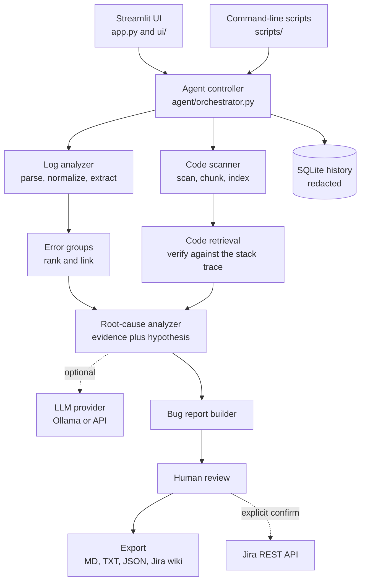
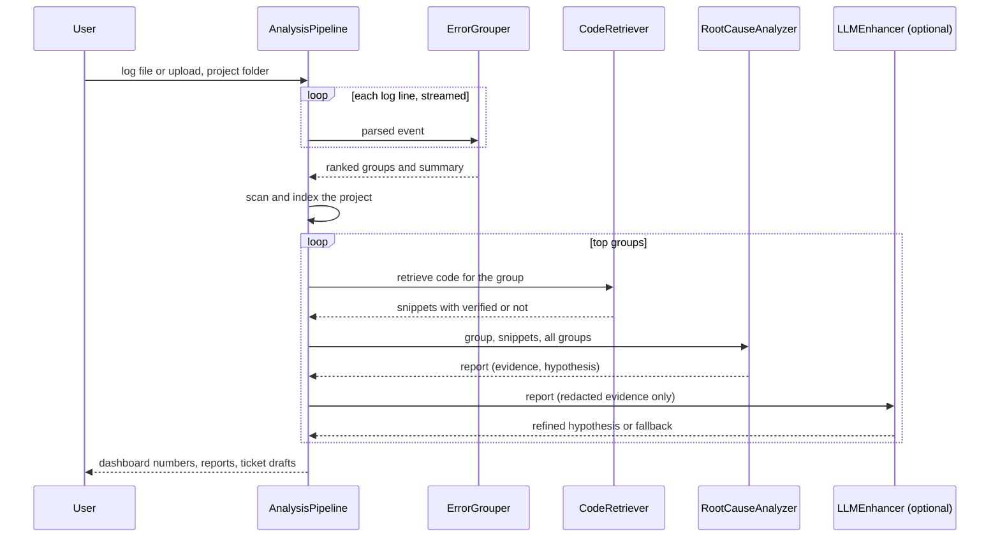
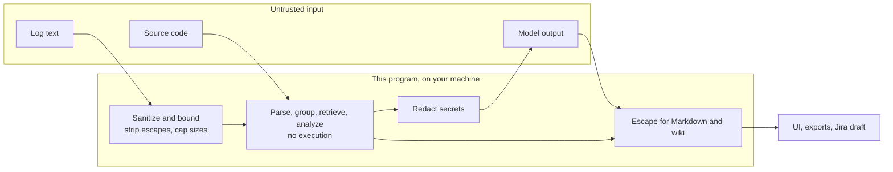

# Architecture

## Components

## Data flow of one analysis

## Trust boundaries

## Principles
- Never send the whole log to a model: parse, group, rank, then send only redacted evidence.
- Observed evidence and inference are separate fields everywhere (report, ticket, UI).
- Works with no LLM; model output is validated and falls back to the deterministic report.
- Uploaded code and logs are only read, never executed; paths named in a log are never opened.
- Display logic is in plain functions (`ui/viewmodels.py`), so it is unit-tested without a browser.

## Main modules
| Module | Responsibility |
|---|---|
| `agent/orchestrator.py` | runs the pipeline, times each stage, contains per-group failures |
| `agent/root_cause_agent.py`, `agent/rules.py` | evidence builders, hypothesis rules, confidence score |
| `log_analyzer/` | `ingest` (safe reading), `parser`, `normalizer`, `extractor` (exception chains and frames), `grouper` |
| `code_analyzer/` | `scanner`, `chunker`, `search` (BM25), `retriever` (verification statuses) |
| `ai/` | providers, `prompts`, `validation`, `redaction`, `enhancer` |
| `reports/` | `jira` (ticket, review, optional REST), `exporters`, `sanitize` |
| `storage/database.py` | redacted run history |
| `ui/` | Streamlit pages over a plain-dict view of a run |
